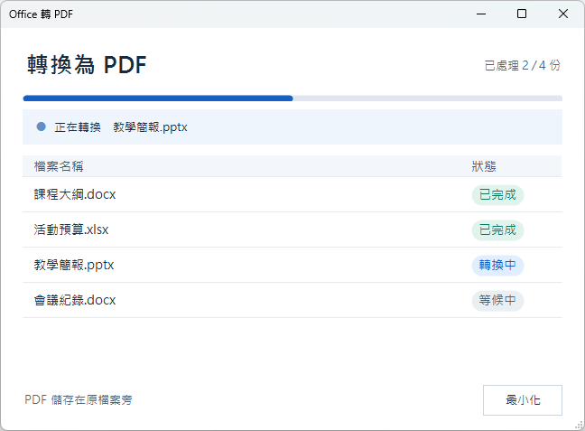

# Right Click Office to PDF

在檔案總管選取一份或多份 Office 文件，按右鍵選 **轉換為 PDF 檔案**。PDF 會存到原檔旁。轉檔使用本機已安裝且啟用的 Microsoft Office 桌面版。

| 檔案 | 使用的 Office 程式 |
| --- | --- |
| DOC、DOCX、ODT | Word |
| PPT、PPTX、ODP | PowerPoint |
| XLS、XLSX、ODS | Excel |

---

## 主要功能

- 單檔、多檔共用一個進度視窗，顯示目前檔名、已處理數量及每份檔案的結果。
- 遇到錯誤會保留 Office 的失敗原因，繼續處理其他檔案。點選成功項目可查看 PDF 的完整路徑。
- 會檢查匯出檔的 PDF 標頭與結尾，再存到原檔旁。同名時自動加上序號。



---

## 單行指令快速安裝 / 移除

使用者可免手動下載 ZIP，只要開啟 **Windows PowerShell**，執行下列指令即可。

### 執行單行指令快速安裝

```powershell
iwr -UseBasicParsing https://raw.githubusercontent.com/kaoshou/right-click-office-to-pdf/main/install.ps1 -OutFile "$env:TEMP\right-click-office-to-pdf-install.ps1"; powershell -NoProfile -ExecutionPolicy Bypass -File "$env:TEMP\right-click-office-to-pdf-install.ps1"
```

### 執行單行指令快速移除

```powershell
iwr -UseBasicParsing https://raw.githubusercontent.com/kaoshou/right-click-office-to-pdf/main/uninstall.ps1 -OutFile "$env:TEMP\right-click-office-to-pdf-uninstall.ps1"; powershell -NoProfile -ExecutionPolicy Bypass -File "$env:TEMP\right-click-office-to-pdf-uninstall.ps1"
```

### 線上安裝安全說明

上述指令會先將 GitHub 上的安裝腳本下載到 Windows 暫存資料夾，再執行該腳本。這比 `irm ... | iex` 更適合對一般使用者公開，因為使用者可以先檢查下載的 `.ps1` 內容。完整說明請見 [`docs/ONLINE_INSTALL.md`](docs/ONLINE_INSTALL.md)。

---

## 手動下載與安裝

請從 [GitHub Releases](https://github.com/kaoshou/right-click-office-to-pdf/releases) 下載正式發行 ZIP 並解壓縮，例如：

```text
C:\Users\你的帳號\Downloads\right-click-office-to-pdf
```

在該資料夾開啟 PowerShell，執行：

```powershell
powershell -ExecutionPolicy Bypass -File .\Install-RightClickOfficeToPDF.ps1
```

安裝程式會將核心檔案複製到：

```text
%LOCALAPPDATA%\RightClickOfficeToPDF
```

Windows 11 x64／ARM64 會從發行 ZIP 註冊對應架構的現代右鍵選單。Windows 10 使用傳統右鍵選單。若使用 GitHub 的「Source code」原始碼壓縮檔，預設只安裝傳統選單。開發版 ZIP 的測試方法請見[部署說明](docs/DEPLOYMENT.md)。

---

## 使用方式

### 單一或多個檔案轉 PDF

1. 在 Windows 檔案總管選取一個或多個支援的檔案，例如 `.docx`、`.pptx`、`.xlsx`。
2. 按右鍵。
3. 點選「轉換為 PDF 檔案」。
4. 在進度視窗查看目前檔案與完成數量。全部成功後視窗會自動關閉；有錯誤時，點選該列即可查看。

```text
右鍵 → 轉換為 PDF 檔案
```

在 Windows 11，若命令只出現在「顯示其他選項」，請先安裝含新版選單的發行 ZIP。若右鍵內有「應用程式擴充功能」，可從中選擇轉檔。要讓命令出現在右鍵第一層，請到 **設定 → 個人化 → 操作功能表 → 應用程式延伸模組**，開啟 **Right Click Office to PDF**。

---

## 輸出規則

PDF 預設輸出到原檔案相同資料夾：

```text
講義.docx   → 講義.pdf
簡報.pptx  → 簡報.pdf
成績表.xlsx → 成績表.pdf
```

若同名 PDF 已存在，工具會自動增加序號，避免覆蓋舊檔：

```text
簡報.pdf
簡報 (1).pdf
簡報 (2).pdf
```

---

## 解除安裝

### 使用一行指令移除

```powershell
iwr -UseBasicParsing https://raw.githubusercontent.com/kaoshou/right-click-office-to-pdf/main/uninstall.ps1 -OutFile "$env:TEMP\right-click-office-to-pdf-uninstall.ps1"; powershell -NoProfile -ExecutionPolicy Bypass -File "$env:TEMP\right-click-office-to-pdf-uninstall.ps1"
```

### 使用本機腳本移除

在專案資料夾中執行：

```powershell
powershell -ExecutionPolicy Bypass -File .\Uninstall-RightClickOfficeToPDF.ps1
```

解除安裝會移除：

```text
目前使用者的 Windows 11 右鍵選單套件
支援格式的右鍵選單登錄設定
%LOCALAPPDATA%\RightClickOfficeToPDF
```

---

## 安全說明摘要

- 本工具只在本機執行，不會上傳文件，不會呼叫雲端 API。
- 轉檔需要 Microsoft Office 桌面版授權。
- 使用 Microsoft Office COM 自動化轉檔時，工具會盡量以唯讀模式開啟檔案，並嘗試停用巨集自動化執行。
- 不建議轉換來源不明、可能含惡意巨集或惡意內容的 Office 文件。
- 若檔案處於保護檢視、密碼保護、開啟需互動確認、或含外部連結提示，背景轉檔可能失敗。
- 一行安裝指令會下載並執行 GitHub 上的 PowerShell 腳本；正式對外發布時，請提醒使用者確認 Repository 來源與腳本內容。

完整安全說明請見 [`SECURITY.md`](SECURITY.md) 與 [`docs/SAFETY.md`](docs/SAFETY.md)。

---

## 已知限制

- Excel 轉 PDF 會受工作表列印範圍、紙張方向、縮放比例影響。
- Office 文件若需要密碼、手動確認、信任中心互動、外部連結確認，可能無法背景轉換。
- PowerPoint 若包含特殊字型、影音、外掛內容，PDF 可能與原始播放效果不同。
- Office 等候密碼或互動視窗時，進度會停在該檔。詳見[疑難排解](docs/TROUBLESHOOTING.md)。

---

## 專案資訊

- Project: `right-click-office-to-pdf`
- Version: `1.1.0`
- Platform: Windows 10 / Windows 11
- Runtime: Windows PowerShell 5.1 或 PowerShell 7+
- Developer: Yu-Han Cheng（鄭郁翰）
- 本版的 Office 轉檔流程、批次進度視窗及 Windows 11 右鍵選單由 OpenAI Codex 協助開發與測試。
- GitHub: `https://github.com/kaoshou/right-click-office-to-pdf`

---

## 免責聲明

本專案最初僅為個人使用需求所開發，現以「現狀（AS IS）」方式提供，不附任何明示或暗示之保證，包含但不限於商業適售性、特定用途適用性及不侵權保證。
使用者應自行承擔使用本軟體之所有風險。對於因使用本軟體所造成之任何直接、間接、附帶、衍生性或特殊損害（包含但不限於資料遺失、文件損毀、轉換錯誤、商業中斷或工作損失等），作者與貢獻者概不負責。
本工具可能涉及 Office 文件、PDF 與其他敏感資料之處理，使用者應自行確認其使用方式符合所在地之法律、組織資訊安全政策及個人資料保護相關規範。
本專案與 Microsoft、Adobe、LibreOffice、The Document Foundation、OSSII 或其他第三方公司或組織無任何附屬、授權、贊助或背書關係。
文件轉換結果仍可能因 Office 版本、字型、版面設定或第三方軟體環境差異而有所不同。對於重要文件，請務必自行再次確認轉換結果之正確性。
繼續使用本軟體即視為您已閱讀、理解並同意上述內容。
